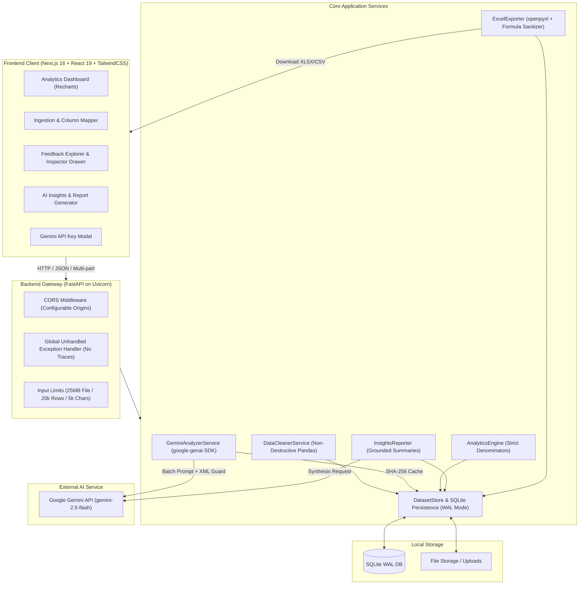

# Customer Feedback Intelligence — AI-Powered Feedback Analysis Platform

[](https://customer-feedback-intelligence-one.vercel.app)
[](https://customer-feedback-intelligence-646h.onrender.com/api/health)
[](https://fastapi.tiangolo.com)
[](https://nextjs.org)
[](https://ai.google.dev)
[](https://python.org)
[](https://typescriptlang.org)
[](https://pytest.org)
[](https://opensource.org/licenses/MIT)

> 🌐 **Live Website**: [https://customer-feedback-intelligence-one.vercel.app](https://customer-feedback-intelligence-one.vercel.app)  
> ⚡ **API Health Endpoint**: [https://customer-feedback-intelligence-646h.onrender.com/api/health](https://customer-feedback-intelligence-646h.onrender.com/api/health)

An enterprise-grade, portfolio-ready customer feedback analytics platform that ingests unstructured customer verbatims from CSV or Excel files, cleans and normalizes records non-destructively, extracts structured sentiment and themes using Google Gemini via the official Google Gen AI SDK (`google-genai`), surfaces interactive analytics and executive reports via Next.js and Recharts, and exports audit-ready multi-sheet Excel workbooks.

---

## 📸 Platform Highlights & Visuals

The application delivers an executive SaaS experience with dark glassmorphism, responsive data visualizations, filterable ledgers, and downloadable business reports.

| Executive Analytics Dashboard | AI Insights & Strategic Synthesis |
| :---: | :---: |
| Real-time KPIs, Sentiment Donut, Volume Trends, Pain Points | Executive summary, positive highlights, actionable recommendations |

| Ingestion & Non-Destructive Normalizer | Multi-Sheet Excel & CSV Exporter |
| :---: | :---: |
| Visual column mapper, preview table, zero record-loss flags | OpenPyXL workbook with formatted cards & formula-injection protection |

---

## 🌟 Key Features

### 1. Robust File Ingestion & Non-Destructive Normalization
- **Multi-Format Support**: Ingests `.csv`, `.tsv`, `.xlsx`, and `.xls` files up to **25 MB** and **20,000 rows**.
- **Auto-Column Detection**: Heuristically matches columns for `feedback_text`, `customer_id`, `submission_date`, `rating`, `category`, and `product`.
- **Zero Record-Loss Guarantee**: Rows with missing fields or unparseable dates are never deleted silently; they are retained and flagged with transparent audit tags (`blank_feedback_text`, `invalid_date_format`, `duplicate_verbatim`).
- **Interactive Ingestion Preview**: Operators review detected columns and first rows before committing normalization.

### 2. Google Gemini Structured Analysis (`google-genai` SDK)
- **Official SDK**: Built with the modern `google-genai` SDK (`from google import genai`) using Google's recommended `gemini-2.5-flash` model.
- **Defensive Classification**:
  - **Sentiment**: Strictly `positive`, `negative`, `neutral`, or `needs_review` (no forced or hallucinated sentiments).
  - **Factual Sentiment Reason**: Concise justification strictly tied to verbatim customer quotes.
  - **Themes & Friction**: Standardized primary themes (`Product Quality`, `Pricing`, `Delivery`, `Usability`, `Customer Support`, `Billing`, `Other`), explicit `pain_points`, and `positive_aspects`.
  - **Urgency Matrix**: `low`, `medium`, `high`, or `needs_review` to triage churn risks.
  - **Internal Confidence Metric**: Discloses internal model confidence without misrepresenting it as a statistical probability.
- **Anti-Prompt-Injection Architecture**: Untrusted customer comments are encapsulated inside `<feedback_entry>` XML blocks with strict instructions treating verbatims as passive text data.
- **Quota & Cost Optimization**:
  - Batched processing in chunks of 10 records.
  - Concurrency control (max 3 concurrent API calls) with exponential backoff and jitter.
  - Per-item fallbacks if any batch response is malformed.
  - **SHA-256 Caching**: Records are indexed by `(record_id, model, prompt_version, input_text_hash)` preventing duplicate API calls on re-analysis.
  - Background task management with real-time progress and a dedicated **Retry Failed Records** capability.

### 3. Interactive Analytics Dashboard (Recharts & Next.js)
- **Compact KPI Cards**: Total Records, Completion Rate, Positive Count, Neutral Count, Negative Count, and Records Requiring Review.
- **Sentiment Distribution**: Recharts interactive Donut chart with accurate denominator disclosures (`Positive + Neutral + Negative`).
- **Time-Series Trends**: Feedback volume area chart and stacked sentiment trends over calendar dates (requires at least 2 distinct dates and 5 dated entries to avoid misleading interpolation).
- **Theme & Pain Points**: Horizontal bar charts of recurring themes and frequency distribution of negative pain points.
- **Category & Channel Breakdowns**: Auto-renders distribution charts when optional category or product columns exist.
- **Deep Filterability**: Instant cross-filtering by date range, sentiment, theme, pain point, and verbatim search queries.
- **Slide-Over Record Inspector**: Accessible drawer showing raw input, cleaned text, audit flags, AI summaries, and sentiment reasons.

### 4. AI Strategic Insights & Multi-Sheet Excel Reports
- **Executive Synthesis**: Generates grounded executive takeaways, top friction areas, positive highlights, and high-impact recommendations backed by record citations.
- **Data Quality Disclosures**: Automatically notes small sample sizes or missing date distributions to prevent misleading business decisions.
- **Multi-Sheet OpenPyXL Workbook**:
  - `Feedback`: Formatted ledger with sentiment badges, themes, and summaries.
  - `Sentiment Summary`: Metric cards, volume counts, and percentage shares.
  - `Theme Summary`: Volume and share breakdown for each detected customer topic.
  - `Data Quality`: Transparent log of accepted, flagged, and skipped rows.
- **Spreadsheet Formula-Injection Protection**: Automatically neutralizes leading `=`, `+`, `-`, `@`, `\t`, and `\r` characters across both Excel (`.xlsx`) and CSV exports.

---

## 🏗️ Architecture & System Design



---

## 📁 Repository Structure

```
AI-Powered Customer Feedback Analysis/
├── backend/
│   ├── app/
│   │   ├── api/
│   │   │   ├── __init__.py
│   │   │   ├── routes_analysis.py    # Background analysis job lifecycle
│   │   │   ├── routes_analytics.py   # Aggregated KPIs, charts, and metrics
│   │   │   ├── routes_datasets.py    # File upload, preview, normalization, sample CSV
│   │   │   ├── routes_export.py      # XLSX multi-sheet & UTF-8-BOM CSV export
│   │   │   ├── routes_feedback.py    # Paginated, searchable record explorer
│   │   │   ├── routes_insights.py    # Executive summary and strategic synthesis
│   │   │   └── routes_system.py      # API key configuration & health checks
│   │   ├── config.py                 # Pydantic BaseSettings & environment configs
│   │   ├── data/
│   │   │   ├── feedback_intelligence.db # SQLite database (WAL mode)
│   │   │   ├── sample_feedback.csv   # 50-row enterprise benchmark dataset
│   │   │   └── sample_feedback_500.csv # 500-row synthetic enterprise dataset
│   │   ├── models/
│   │   │   ├── __init__.py
│   │   │   ├── analysis.py           # Gemini prompt outputs & job schemas
│   │   │   ├── feedback.py           # Normalized customer feedback records
│   │   │   └── responses.py          # Unified StandardResponse wrapper
│   │   ├── services/
│   │   │   ├── __init__.py
│   │   │   ├── analytics_engine.py   # Aggregation, percentages, and time-series
│   │   │   ├── data_cleaner.py       # Non-destructive Pandas normalization
│   │   │   ├── dataset_store.py      # SQLite repository & seeded fixtures
│   │   │   ├── excel_exporter.py     # OpenPyXL 4-sheet styling & formula sanitizer
│   │   │   ├── gemini_analyzer.py    # google-genai SDK, caching, backoff, retry
│   │   │   └── insights_reporter.py  # Grounded executive summary reporter
│   │   └── main.py                   # FastAPI initialization, CORS, exception handler
│   ├── tests/
│   │   ├── test_ai_insights.py       # Insights generator & export integration tests
│   │   ├── test_analytics_engine.py  # KPI calculations & math assertions
│   │   ├── test_api_routes.py        # System health & API route contracts
│   │   ├── test_dashboard_analytics.py # Missing dates, zero records, denominators
│   │   ├── test_data_cleaner.py      # Whitespace, unicode, non-destructive audit
│   │   ├── test_dataset_ingestion.py # Upload, file limits, sample CSV stream
│   │   ├── test_excel_exporter.py    # Excel styling, sheets, formula injection defense
│   │   └── test_gemini_analysis.py   # Mocked Gemini responses, caching, retry logic
│   ├── .env.example                  # Backend environment template
│   ├── pytest.ini                    # Pytest configuration
│   └── requirements.txt              # Backend Python dependencies
│
├── frontend/
│   ├── app/
│   │   ├── globals.css               # Design tokens, dark mode gradients, utilities
│   │   ├── layout.tsx                # App shell, fonts, navigation header
│   │   ├── page.tsx                  # Executive Analytics Dashboard
│   │   ├── insights/
│   │   │   └── page.tsx              # AI Executive Insights & Report Center
│   │   ├── records/
│   │   │   └── page.tsx              # Feedback Explorer & Record Inspector
│   │   └── upload/
│   │       └── page.tsx              # File Upload & Column Mapping Wizard
│   ├── components/
│   │   ├── dashboard/                # Recharts Donut, Trend, Themes, Pain Points
│   │   ├── layout/                   # Topbar, Navigation, API Key Modal
│   │   ├── records/                  # Filter toolbar, paginated table, drawer
│   │   └── upload/                   # Dropzone, column mapper, audit card
│   ├── lib/
│   │   ├── api.ts                    # Strongly-typed API client
│   │   └── types.ts                  # Shared TypeScript interfaces
│   ├── .env.example                  # Frontend environment template
│   ├── eslint.config.mjs             # ESLint configuration
│   ├── next.config.ts                # Next.js configuration
│   ├── package.json                  # Frontend dependencies
│   └── tsconfig.json                 # TypeScript compiler configuration
│
├── sample_data/
│   └── sample_feedback.csv           # 50 enterprise feedback test records
├── .gitignore                        # Git exclusion rules (.env, *.db, *.xlsx)
└── README.md                         # Comprehensive documentation
```

---

## ⚙️ Prerequisites

- **Node.js**: `v18.18+` or `v20+` with `npm`
- **Python**: `v3.10+`, `v3.11+`, or `v3.12+`
- **Google Gemini API Key**: Free or paid key from [Google AI Studio](https://aistudio.google.com/app/apikey)

---

## 🔑 Obtaining & Configuring Your Gemini API Key

1. Navigate to [Google AI Studio](https://aistudio.google.com/app/apikey) and sign in with your Google account.
2. Click **Create API key** and copy your generated key string.
3. You can supply the key via **either** of two secure methods:
   - **Method A (Persistent .env)**: Paste into `backend/.env`:
     ```bash
     GEMINI_API_KEY=AIzaSyYourSecretKeyHere...
     GEMINI_MODEL=gemini-2.5-flash
     ```
   - **Method B (In-App Session Modal)**: Launch the frontend, click the **"Configure API Key"** button in the top navigation bar, paste your key, and click Save. The backend validates and updates credentials for your session without ever displaying your unmasked key.

---

## 🚀 Installation & Local Setup

### 1. Backend Installation & Server Startup

Open a terminal in the root directory:

```bash
# Navigate to backend directory
cd backend

# Create and activate a Python virtual environment
python -m venv venv
venv\Scripts\activate       # Windows PowerShell / CMD
# source venv/bin/activate  # macOS / Linux

# Install backend dependencies
pip install -r requirements.txt

# Create your .env file from the template
copy .env.example .env      # Windows
# cp .env.example .env       # macOS / Linux

# Start the FastAPI server with live reload
python -m uvicorn app.main:app --host 127.0.0.1 --port 8000 --reload
```

The FastAPI backend will start on **`http://127.0.0.1:8000`**.  
Interactive Swagger API documentation is available at **`http://127.0.0.1:8000/docs`**.

### 2. Frontend Installation & Server Startup

Open a second terminal in the root directory:

```bash
# Navigate to frontend directory
cd frontend

# Install dependencies
npm install

# Start the Next.js development server
npm run dev
```

The Next.js frontend will be running at **`http://localhost:3000`**.

---

## 📊 Sample Datasets & Verification Instructions

The platform provides multiple ways to test and explore realistic feedback data:

1. **Pre-Seeded Dataset (`sample-saas`)**:
   - The application automatically pre-seeds 50 fully-analyzed, realistic SaaS customer feedback records across diverse channels (In-App Survey, Support Ticket, Email, Web Form).
   - Select `SaaS Feedback Benchmark (50 records)` in the global dataset dropdown on the dashboard or insights page to immediately inspect charts and reports.

2. **Download Synthetic 500-Record CSV**:
   - Visit `http://127.0.0.1:8000/api/datasets/sample-csv` or click the **"Download Sample CSV"** button on the Upload page (`/upload`).
   - The file `customer_feedback_sample_500.csv` will download containing 500 realistic records with mixed ratings, dates, and channels.

3. **Upload Your Own Dataset**:
   - Navigate to `/upload`.
   - Drag and drop any `.csv` or `.xlsx` file.
   - Use the visual column mapper to confirm or adjust column associations.
   - Click **"Normalize Dataset"** to review the data quality audit card (accepted rows, flagged rows, skipped rows).
   - Click **"Analyze with Gemini"** to initiate batch classification.

---

## 🧪 Testing Commands

### Backend Tests (Pytest)
Run the automated test suite covering data cleaning, Excel export, formula sanitization, Gemini caching, mock retries, and API routes:

```bash
cd backend
python -m pytest -v
```

**Expected Result**: `40 passed in ~8-9s` (100% green).

### Frontend Typecheck & Production Build
Validate TypeScript typings and build the production bundle:

```bash
cd frontend

# Run TypeScript type check
npx tsc --noEmit

# Run Next.js production build
npm run build
```

**Expected Result**: Zero TypeScript errors; Next.js static site generator completes compiling all pages (`/`, `/insights`, `/records`, `/upload`).

---

## 📡 API Endpoint Reference

| Method | Endpoint | Description |
| :--- | :--- | :--- |
| `GET` | `/api/health` | Service health status and active Gemini model name |
| `GET` | `/api/system/status` | Gemini API configuration status and masked key |
| `POST` | `/api/system/configure-key` | Dynamically updates session API key and model |
| `POST` | `/api/system/load-sample` | Reloads the default 50-record SaaS benchmark dataset |
| `POST` | `/api/datasets/upload` | Uploads CSV/Excel file (up to 25MB) and detects columns |
| `GET` | `/api/datasets/{id}/preview` | Paginated raw tabular preview of uploaded file |
| `POST` | `/api/datasets/{id}/normalize` | Non-destructively normalizes dataset with column mappings |
| `GET` | `/api/datasets/{id}/summary` | Returns data quality breakdown and flagged reason counts |
| `GET` | `/api/datasets/sample-csv` | Streams the 500-entry synthetic benchmark CSV |
| `POST` | `/api/analysis/start` | Initiates Gemini batch analysis for unclassified records |
| `GET` | `/api/analysis/jobs/{job_id}` | Polls progress, processed records, failures, and cache hits |
| `POST` | `/api/analysis/jobs/{job_id}/retry-failed` | Retries failed records from an analysis run |
| `GET` | `/api/feedback` | Paginated, searchable, multi-filtered customer feedback list |
| `GET` | `/api/feedback/{record_id}` | Returns single record detail with Gemini rationale and audit flags |
| `GET` | `/api/analytics` | Aggregates KPIs, sentiment distribution, trends, and pain points |
| `GET` | `/api/insights` | Generates or retrieves grounded executive synthesis report |
| `GET` | `/api/export/excel` | Generates 4-sheet styled Excel workbook (`.xlsx`) |
| `GET` | `/api/export/csv` | Streams sanitized, filtered dataset as UTF-8-BOM CSV |

---

## 🔒 Security & Data Protection Review

1. **API Key & Secret Handling**:
   - `GEMINI_API_KEY` is loaded securely via Pydantic `BaseSettings` from `backend/.env`.
   - `.env` and `.env.local` are explicitly listed in `.gitignore` and never committed to source control.
   - When queried via `GET /api/system/status`, keys are strictly masked (e.g., `AIza...912a`). Plaintext keys are never output to logs or sent to browser clients.
2. **Formula Injection Sanitization (CSV & Excel Injection)**:
   - In accordance with OWASP spreadsheet export guidelines, all string values beginning with `=`, `+`, `-`, `@`, `\t`, or `\r` are sanitized by prepending a single quote `'` in both OpenPyXL workbooks and CSV downloads (`sanitize_formula_injection`).
3. **Anti-Prompt-Injection Safeguards**:
   - User-supplied verbatims are isolated within `<feedback_entry>` XML containers in Gemini prompt templates.
   - Explicit system instructions enforce that verbatim text must only be analyzed as passive customer sentiment data, disallowing instruction overrides.
4. **Input Limits & Resource Protection**:
   - Upload file size capped at **25 MB** (`MAX_UPLOAD_SIZE_BYTES`).
   - Maximum row ingestion capped at **20,000 rows** (`MAX_ROW_COUNT`).
   - Verbatim string threshold capped at **5,000 characters** (`MAX_TEXT_LENGTH`).
5. **Safe Error Handling**:
   - FastAPI unhandled exception middleware catches raw exceptions and responds with uniform HTTP 500 JSON envelopes, preventing internal python stack traces from leaking to clients.
6. **CORS Hardening**:
   - CORS is restricted to designated origins (`settings.CORS_ORIGINS`) in production mode.

---

## 📝 Sample Feedback Records

A preview of realistic synthetic customer verbatims included in `sample_data/sample_feedback.csv`:

```csv
feedback_id,created_at,rating,channel,customer_feedback
FB-1001,2025-01-05 09:14:22,5,In-App Survey,"The new analytics dashboard is blazing fast! Our leadership team reviewed quarterly metrics in half the usual time. Exceptional work."
FB-1002,2025-01-05 11:30:10,1,Support Ticket,"Your billing department charged us twice for our enterprise tier this month! We opened a ticket 3 days ago with zero response. Unacceptable!"
FB-1003,2025-01-06 14:22:15,3,Email Feedback,"The tool is functional and does what we need, but the navigation menus are cluttered. It takes 4 clicks just to find saved reports."
FB-1004,2025-01-06 16:45:00,5,Customer Review,"Customer support rep Marcus solved our SSO setup issue in under 10 minutes. Extremely knowledgeable and courteous service."
FB-1005,2025-01-07 08:12:43,2,In-App Survey,"CSV export keeps timing out when attempting to download more than 5,000 rows. We have to export in small batches which ruins our workflow."
```

---

## ⚠️ Known Limitations & Future Roadmap

- **Single-Node Worker Architecture**: Background batching currently uses Python `asyncio` tasks with SQLite WAL. For enterprise deployments exceeding 100,000 rows, a distributed queue (e.g., Celery or Temporal with Redis/PostgreSQL) is recommended.
- **Multi-Tenant Authentication**: Currently relies on session and database persistence without user login. A future release will introduce Supabase / Auth0 role-based access control.
- **Multilingual Tokenization**: While Gemini natively translates and analyzes non-English feedback accurately, language-specific stop-word filtering could further refine automated keyword extraction.

---

## 📄 License

This project is licensed under the [MIT License](LICENSE).
